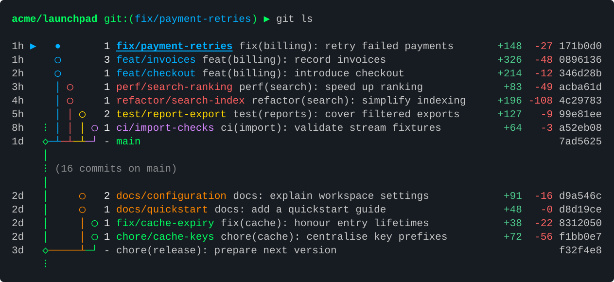

# git-ls

`git-ls` renders local Git branch stacks as compact coloured lanes for use as `git ls`.



## Glyph System

The graph uses `git-branchless` glyphs for equivalent concepts, with branch heads arranged above their ancestors.
Stacks with a common downstack path share that path and connect through a junction above the shared branch point.
Each uninterrupted stack segment retains one colour, and a shared downstack segment receives its own colour after its child stacks join.
The built-in palette is assigned according to coloured footprint, visual adjacency and colour-family exposure, with larger stacks preferentially avoiding coral and green.
The [colour-assignment policy](docs/colour-assignment.md) specifies the deterministic heuristic and its limitations.
The following example uses synthetic branch names:

```text
    ◯   feature/search
    │ ◯ feature/export
    ├─┘
▶   ●   feature/api
  ⁝ ◯   feature/base
  ◇─┘   main
```

| Symbol | Meaning |
| --- | --- |
| `●` | Current branch head. |
| `◯` | Non-current branch head or branch point. |
| `◉` | Branch point at `HEAD` when it is not the current named branch, including a detached `HEAD`. |
| `◇` | Main-history node. |
| `◆` | Current main-history node. |
| `⦸` | Branch group orphaned from main history, labelled `(orphaned)` and rendered in a separate grey lane excluded from stack colour assignment. |
| `✕` | Rewritten commit, accompanied by its replacement commit. |
| `▶` | Current branch row indicator in the leading gutter. |
| `│` | Visible main or stack ancestry. |
| `⁝` | Omitted main-history continuation; a counted form, such as `⁝ (12 commits on main)`, denotes a collapsed segment. |
| `──` | Horizontal ancestry connection, or an empty connection stub beside a main-history node. |
| `├` | Junction joining child stacks to their shared downstack path. |
| `─┴` | Intermediate connection into a stack lane. |
| `─┘` | Final connection into a stack lane. |

## Mainline references

When the selected local main branch has an available remote upstream, the graph displays both reference positions.
The upstream is labelled `origin/main (cached)`, or the corresponding configured reference name, to identify locally recorded remote state without asserting that it is current.
The command performs no fetch.
Coincident references share one node, such as `main, origin/main (cached)`.
Different reference positions remain visible even when no feature branch attaches to either position.
Collapsed history between local main and an upstream ahead of it is labelled with the upstream name, for example `(2 commits on origin/main)`.
When local main is ahead, the corresponding segment retains the label `(2 commits on main)`.
Divergent histories retain separate ancestry paths, and feature counts and tree comparisons begin at recognised mainline or preceding stack boundaries.
Displayed ages denote commit ages and do not indicate remote freshness.
Repositories without an available configured remote upstream retain the local-main display.

## Integration Support

Supported VCS backends are:

- Git, optionally using [git-branchless](https://github.com/arxanas/git-branchless) for custom revsets and hidden-commit selection.

Git is required for both the native `gix` backend and the Git subprocess backend.

## Installation

Source installation requires Rust.

```sh
cargo install --path . --locked
```

Installation details and display examples are documented in [common commands](docs/commands.md).

## Configuration

Settings reside in the `[git-ls]` section of Git configuration.
Example `~/.gitconfig` section:

```gitconfig
[git-ls]
    backend = gix
    layout = columns
    verbosity = 2
    cache = true
    cacheMaintenance = true
```

Option definitions and precedence are documented in [configuration](docs/configuration.md).
Verbosity `2` includes per-layer added and deleted line counts; `--diff-stat`, `--no-diff-stat` and `git-ls.diffStat` override that preset.
Development instructions appear in [development](docs/development.md).
